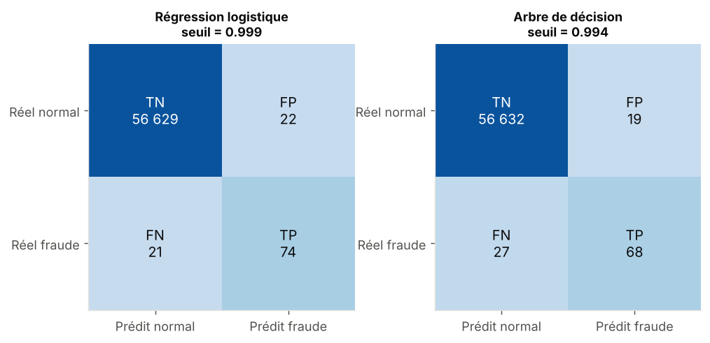
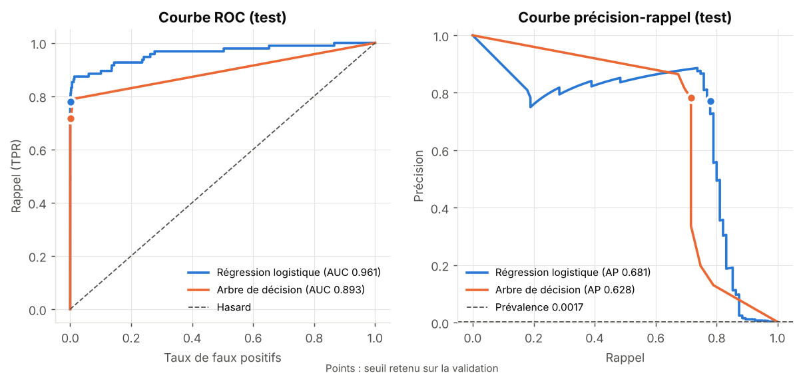
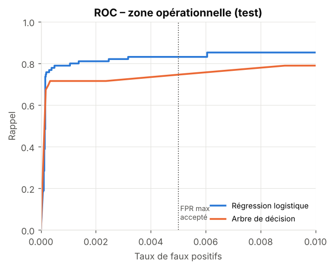
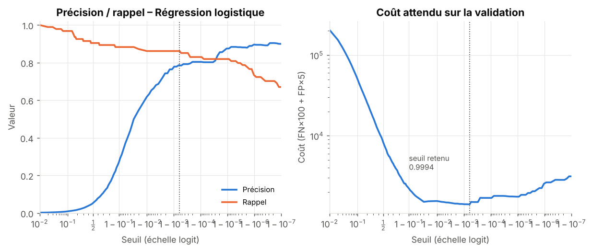

# 2. Rapport d'évaluation ML (Parties III et VI.1)

Reproduction : `python scripts/run_experiments.py --data data/creditcard.csv` (≈ 1 min).
Les résultats bruts sont dans `reports/results/experiments.json`.

## 2.1 Protocole

| Étape | Données utilisées | Détail |
|---|---|---|
| Déduplication | toutes | 1 081 doublons exacts retirés **avant** la partition, pour qu'une même transaction ne se retrouve pas à la fois en entraînement et en test. |
| Partition | toutes | Stratifiée 60 / 20 / 20, graine 42 |
| Ajustement des transformations | **entraînement** | `log1p(Amount)` puis standardisation de toutes les variables, ajustées dans un `Pipeline` scikit-learn. |
| Hyperparamètres | **validation** | Régression logistique : C ∈ {0,01 ; 0,1 ; 1}. Arbre : profondeur ∈ {4, 6, 8} × min_leaf ∈ {20, 50}. Critère : Average Precision. |
| Seuil de décision | **validation** | Minimisation de `100·FN + 5·FP`. |
| Choix du modèle final | **validation** | Meilleure AP de validation : régression logistique (0,791 contre 0,695). |
| Évaluation finale | **test**, exécution **unique** | Comparaison aux critères fixés à l'avance dans `app/config.py`. |

| Partition | Transactions | Fraudes | Prévalence |
|---|---:|---:|---:|
| Entraînement | 170 235 | 284 | 0,167 % |
| Validation | 56 745 | 94 | 0,166 % |
| Test | 56 746 | 95 | 0,167 % |

Les deux modèles utilisent `class_weight="balanced"` pour compenser le déséquilibre (environ 1 fraude pour 600 transactions).

## 2.2 Tableau comparatif des modèles (jeu de test)

| Métrique | Régression logistique | Arbre de décision | Critère | Modèle trivial « tout normal » |
|---|---:|---:|---:|---:|
| Hyperparamètres | C = 0,01 | profondeur 8, min_leaf 20 | — | — |
| Seuil (validation) | 0,9994 | 0,9942 | — | — |
| **Précision** | **0,771** [0,698 – 0,847] | 0,782 [0,702 – 0,864] | ≥ 0,30 | 0 |
| **Rappel** | **0,779** [0,695 – 0,863] | 0,716 [0,621 – 0,800] | ≥ 0,75 | 0 |
| F1 | 0,775 | 0,747 | — | 0 |
| **ROC-AUC** | **0,961** | 0,893 | ≥ 0,95 | non défini |
| **PR-AUC (AP)** | **0,681** [0,574 – 0,786] | 0,628 [0,528 – 0,729] | ≥ 0,70 | ≈ 0,0017 |
| FPR | 0,039 % (22 / 56 651) | 0,034 % | ≤ 0,5 % | 0 % |
| FNR | 22,1 % (21 / 95) | 28,4 % | — | 100 % |
| Accuracy | 99,92 % | 99,92 % | non utilisée | **99,83 %** |
| Critères atteints | **4 / 5** (échec sur l'AP) | 2 / 5 | 5 / 5 | — |
| Temps de recherche sur grille | 1,0 s | 22,4 s | — | — |

Les valeurs entre crochets sont des intervalles de confiance à 95 % obtenus par bootstrap stratifié (1 000 tirages).

**Lecture des courbes.** La courbe ROC paraît excellente pour les deux modèles, mais elle est dominée par les 56 651 transactions normales. C'est la courbe précision-rappel qui les départage. L'arbre produit une courbe en escalier : il ne génère que quelques scores distincts, un par feuille. Au-delà de 72 % de rappel, il ne gagne en rappel qu'au prix d'un effondrement de la précision. La régression logistique maintient une précision d'environ 0,8 jusqu'à 78 % de rappel.

## 2.3 Pourquoi une accuracy très élevée peut ne rien signifier

Un modèle qui répond « normal » pour toutes les transactions obtient **99,83 %** d'accuracy sur le test sans détecter **aucune** fraude : rappel 0, FNR 100 %. Le test `test_high_accuracy_can_hide_zero_recall` le vérifie automatiquement.

La raison : avec 0,17 % de fraudes, l'accuracy mesure presque uniquement le taux de vrais négatifs. Même les 99,92 % de la régression logistique ne se distinguent du modèle trivial que de 0,09 point, alors que les deux systèmes n'ont rien de comparable (74 fraudes détectées contre 0). La qualification repose donc sur le rappel, la précision, la PR-AUC et le FPR, jamais sur l'accuracy.

## 2.4 Analyse des faux positifs et des faux négatifs (régression logistique, test)

| Groupe | n | Probabilité médiane | Montant médian | Montant moyen | Montant total |
|---|---:|---:|---:|---:|---:|
| TP (fraudes détectées) | 74 | ≈ 1,000 | 31,99 | 148,32 | 10 975,97 |
| **FN (fraudes manquées)** | **21** | 0,179 | **1,79** | 180,49 | **3 790,34** |
| **FP (fausses alertes)** | **22** | ≈ 1,000 | 89,99 | 1 540,90 | — |
| TN | 56 629 | 0,023 | 21,59 | 88,14 | — |

Constats :

* **Les fraudes manquées forment deux familles.** 9 sur 21 ont un score supérieur à 0,69 mais inférieur au seuil très élevé (0,9994). Ce sont des cas proches de la frontière qu'un seuil plus bas rattraperait, au prix de plus de fausses alertes. Les 12 autres ont un score inférieur à 0,3 : le modèle ne les voit pas du tout. Elles ressemblent à des transactions normales dans l'espace ACP.
* **Beaucoup de fraudes manquées sont des micro-montants** : médiane de 1,79, et 13 sur 21 en dessous de 4. Ce profil évoque le « test de carte », où de petits montants servent à vérifier qu'une carte fonctionne. Le modèle les détecte mal. En montant, les 21 FN représentent toutefois 26 % du montant fraudé (3 790 sur 14 766).
* **Les faux positifs sont des transactions à montant élevé** (moyenne 1 541 contre 88 pour les TN) que le modèle note presque à 1. Ce sont des achats atypiques légitimes. Les bloquer coûte cher en expérience client, ce qui plaide pour une authentification renforcée plutôt qu'un blocage sec.
* **Attention à la calibration** : le seuil de 0,9994 montre que les scores ne sont **pas des probabilités calibrées**. La pondération `balanced` les gonfle. Une « probabilité » de 0,98 présentée à un analyste serait trompeuse (anomalie A4).

## 2.5 Compromis lié au seuil (validation)

| Seuil (validation) | Précision | Rappel | FP | FN | Coût |
|---|---:|---:|---:|---:|---:|
| 0,5 (par défaut) | 0,054 | 0,904 | 1 479 | 9 | 8 295 |
| **0,9994 (retenu)** | **0,786** | **0,862** | **22** | **13** | **1 410** |

Le seuil par défaut de 0,5 produirait **1 479 fausses alertes** pour 85 fraudes détectées, soit plus de 17 fausses alertes par fraude. Le seuil fondé sur le coût divise le coût par 6 en ne perdant que 4 fraudes. La courbe de coût est plate autour de l'optimum, entre 1 − 10⁻² et 1 − 10⁻⁴ : le choix est donc peu sensible aux valeurs exactes des coûts. Un autre ratio de coûts déplacerait le seuil (`test_threshold_moves_with_cost_ratio`).

## 2.6 Validation hors échantillon et surapprentissage

| Modèle | AP entraînement | AP validation | AP test | Écart entraînement − test |
|---|---:|---:|---:|---:|
| Régression logistique | 0,728 | 0,791 | 0,681 | **0,047** |
| Arbre de décision | 0,759 | 0,695 | 0,628 | **0,131** |

* **Arbre** : surapprentissage net (ROC-AUC de 0,999 en entraînement contre 0,893 en test), au-delà de la tolérance de 0,10. La validation l'a écarté, comme prévu.
* **Régression logistique** : l'écart entre entraînement et test reste modéré (0,047). L'écart entre **validation et test** est en revanche important (0,791 → 0,681), sans aucun réglage sur le test. Avec environ 95 fraudes par partition, quelques fraudes difficiles suffisent à faire varier l'AP de 0,1. L'intervalle bootstrap à 95 % de l'AP de test, [0,574 ; 0,786], contient à la fois la valeur de validation et le critère de 0,70. **La mesure est trop incertaine pour conclure dans un sens comme dans l'autre.** C'est la principale limite de l'évaluation.
* **Validation temporelle** (`run_robustness.py`) : ré-entraîné sur les 33 premières heures et évalué sur les 7,7 dernières, le modèle obtient une AP de 0,728 mais un **rappel de 0,689** (< 0,75). La partition aléatoire surestime donc légèrement la performance par rapport à un déploiement réel, où le modèle note des transactions futures.

## 2.7 Critères d'acceptation métier : verdict

| Critère | Seuil | Résultat sur le test | Verdict |
|---|---|---|---|
| ROC-AUC | ≥ 0,95 | 0,961 | ✅ |
| PR-AUC | ≥ 0,70 | **0,681** (IC 95 % : 0,574 – 0,786) | ❌ |
| Rappel | ≥ 0,75 | 0,779 (IC 95 % : 0,695 – 0,863) | ✅ (borne basse sous le critère) |
| Précision | ≥ 0,30 | 0,771 | ✅ |
| FPR | ≤ 0,5 % | 0,039 % | ✅ |

**Le modèle n'atteint pas le critère de PR-AUC fixé à l'avance.** Conformément au protocole, ni les critères ni le modèle n'ont été modifiés après observation du jeu de test. Tout nouveau modèle (calibration, suppression de `Time`, boosting) devra être sélectionné sur la validation, **puis évalué sur des données nouvelles, jamais vues**. Le jeu de test actuel est désormais « consommé ».
