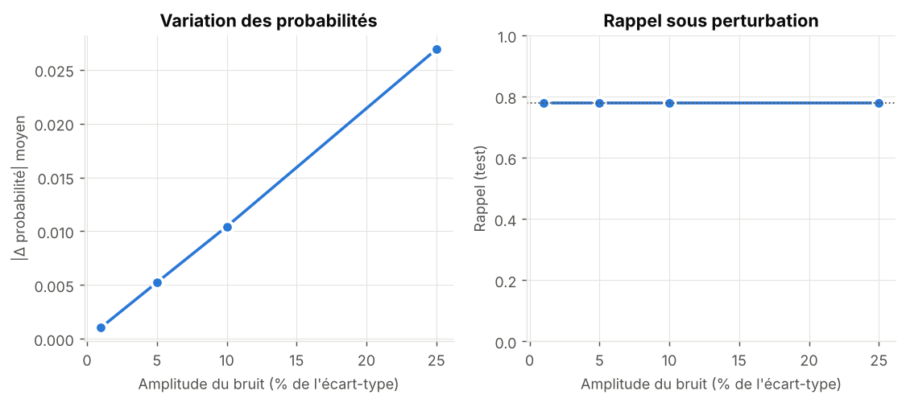

# 3. Rapport de robustesse et de non-régression (Parties IV, V et VI.2)

Reproduction :

```bash
python scripts/run_robustness.py --data data/creditcard.csv   # -> results/robustness.json
python scripts/compare_baseline.py --data data/creditcard.csv # -> results/regression_comparison.json
pytest tests/test_integration.py tests/test_robustness.py tests/test_regression.py
```

Le modèle évalué est le modèle v1.0 (régression logistique, seuil 0,9994), appliqué au jeu de test réel (56 746 transactions, 95 fraudes). Le générateur aléatoire des perturbations utilise la graine 2024.

## 3.1 Intégration : preuve de reproductibilité du pipeline sauvegardé

| Contrôle | Méthode | Résultat |
|---|---|---|
| Prédictions avant et après `save_model` / `load_model` | écart absolu maximal des probabilités | ≤ 1e-9 (tolérance `REPRO_ATOL`), décisions identiques ✅ |
| Seuil et métadonnées conservés | égalité stricte | ✅ |
| Deux entraînements complets identiques | même CSV, même graine | probabilités identiques à 1e-9 près, même seuil ✅ |
| Graine différente (v1.1-d ci-dessous) | métriques de validation | strictement identiques ✅ (solveur lbfgs déterministe) |
| Scaler ajusté sur l'entraînement seul | `mean_` du scaler comparée aux moyennes de l'entraînement, du test et de l'ensemble | égale à l'entraînement, différente des deux autres ✅ |
| Empreinte du modèle | SHA-256 vérifiée **avant** la désérialisation | `951e69d6bbc8…`, fichier altéré refusé ✅ |
| Erreurs de chargement | fichier absent, tronqué, objet étranger, CSV non UTF-8 | `ModelLoadError` ou `DataValidationError` explicites ✅ |

## 3.2 Scénarios de robustesse

### Entrées invalides : comportement attendu, le rejet

| Scénario (sur le jeu de test réel) | Attendu | Obtenu | Message (extrait) |
|---|---|---|---|
| NaN dans V14 (1 % des lignes, 567) | rejet | ✅ rejeté | « Valeurs manquantes (567 lignes) dans : ['V14'] » |
| NaN dans Amount, V1 et V2 (1 %) | rejet | ✅ rejeté | idem, avec les 3 colonnes |
| +inf dans Amount (1 %) | rejet | ✅ rejeté | « Valeurs infinies… » |
| −inf dans V3 (1 %) | rejet | ✅ rejeté | « Valeurs infinies… » |
| Montant négatif (1 %) | rejet | ✅ rejeté | « Valeurs négatives interdites… » |
| Texte « N/A » dans V10 (1 %) | rejet | ✅ rejeté | « Type non numérique pour : ['V10'] » |
| Colonne V28 absente | rejet | ✅ rejeté | « Colonnes requises absentes : ['V28'] » |
| Colonne renommée (`Amount` → `amount`) | rejet | ✅ rejeté | idem |
| Colonne V1 dupliquée | rejet | ✅ rejeté | « Colonnes dupliquées… » |
| Lot vide | rejet | ✅ rejeté | « Le jeu de données est vide. » |
| Colonne supplémentaire `merchant_id` | traitement | ✅ ignorée, avertissement nominatif | — |

**Anomalie A5.** Le rejet porte sur le **lot entier** : 567 lignes invalides ont fait rejeter les 56 746 transactions. C'est acceptable pour une requête unitaire, mais pas pour un traitement par lots en production. Il faudrait rejeter ligne par ligne et renvoyer la liste des lignes refusées.

### Montants extrêmes : traitement et alerte

| Scénario | Rappel | Précision | FPR | Alertes hors domaine | Changements de classe | \|Δp\| moyen / P99 |
|---|---:|---:|---:|---:|---:|---:|
| Référence | 0,779 | 0,771 | 0,039 % | 8 | — | — |
| Amount × 10 | 0,779 | 0,771 | 0,039 % | 153 | 0 | 0,0099 / 0,050 |
| Amount × 100 | 0,779 | 0,771 | 0,039 % | 5 920 | 0 | 0,022 / 0,102 |
| Amount = 2 × maximum d'entraînement (39 313) | 0,779 | 0,771 | 0,039 % | 56 746 | 0 | 0,038 / 0,197 |
| Amount = 1e9 | 0,789 | 0,743 | 0,046 % | 56 746 | 5 (normal → fraude) | 0,119 / 0,403 |

Les montants aberrants sont **traités sans erreur numérique** grâce à log1p, et **signalés** par l'alerte hors domaine. Constat important : le modèle réagit **très peu au montant**. Multiplier tous les montants par 100 ne change aucune décision. Le montant pèse peu dans la régression logistique par rapport aux composantes V. C'est cohérent avec l'analyse des faux négatifs : les micro-montants de type « test de carte » ne sont pas exploités.

### Perturbations limitées : sensibilité mesurée

Les perturbations sont choisies par type de variable, sans appliquer le même bruit à toutes les colonnes :

* **V1 à V28** : bruit gaussien proportionnel à l'écart-type de chaque composante (incertitude de mesure en amont de l'ACP) ;
* **Amount** : perturbation multiplicative de ±1 % ou ±5 % (arrondis, frais, conversion de devises) ;
* **Time** : décalage de ±60 s ou ±1 h (horloge, fuseau horaire).

| Perturbation | Rappel | Précision | FPR | Changements de classe | \|Δp\| moyen | \|Δp\| P99 |
|---|---:|---:|---:|---:|---:|---:|
| V : σ = 1 % | 0,779 | 0,771 | 0,039 % | 0 | 0,0010 | 0,009 |
| V : σ = 5 % | 0,779 | 0,771 | 0,039 % | 0 | 0,0052 | 0,047 |
| V : σ = 10 % | 0,779 | 0,771 | 0,039 % | 0 | 0,0104 | 0,091 |
| V : σ = 25 % | 0,779 | 0,779 | 0,037 % | 3 | 0,027 | 0,231 |
| Amount ± 1 % | 0,779 | 0,771 | 0,039 % | 0 | 0,00002 | 0,0002 |
| Amount ± 5 % | 0,779 | 0,771 | 0,039 % | 0 | 0,00009 | 0,0008 |
| Time ± 60 s | 0,779 | 0,771 | 0,039 % | 0 | 0,00002 | 0,0001 |
| Time ± 1 h | 0,779 | 0,771 | 0,039 % | 0 | 0,0010 | 0,008 |



* La variation des probabilités croît **linéairement** avec l'amplitude du bruit (comportement attendu d'un modèle linéaire), et les métriques restent stables jusqu'à σ = 25 %.
* Les décisions sont stables parce que presque aucune transaction n'est proche du seuil. L'écart médian au seuil en logit vaut 11,2, et seules 0,007 % des transactions sont à moins d'une unité de logit du seuil. Un changement de classe ne se produit donc que près de la frontière, ce que vérifie `test_class_flips_happen_only_near_the_decision_boundary`.
* « Time ± 1 h » déclenche 236 alertes hors domaine : les transactions des dernières heures dépassent le maximum de `Time` vu en entraînement. C'est un premier signe de l'anomalie A2.

### Dérive de distribution : comportement attendu, l'alerte

| Scénario | PSI max (variable) | Variables en alerte (PSI ≥ 0,25) | Rappel | Précision | Alertes | Changements de classe |
|---|---|---:|---:|---:|---:|---:|
| Test non perturbé (contrôle) | 0,0005 (V25) | 0 | 0,779 | 0,771 | 96 | 0 |
| Amount × 1,1 (inflation, devise) | 0,005 (Amount) | 0 | 0,779 | 0,771 | 96 | 0 |
| Amount × 1,5 | 0,151 (Amount, « surveiller ») | 0 | 0,779 | 0,771 | 96 | 0 |
| V14 décalée de +0,5 σ | 0,409 (V14) | 1 | 0,768 | 0,777 | 94 | 2 |
| V4, V11, V12, V14 décalées de 1 σ | 1,584 (V12) | 4 | 0,789 | **0,560** | 134 | 38 |

* Le PSI détecte correctement les dérives sur les composantes V. Le décalage de 4 variables discriminantes fait chuter la précision de 0,77 à 0,56 : la surveillance de ces variables est prioritaire.
* **Anomalie A6** : une hausse de 10 % des montants passe **inaperçue** (PSI 0,005), parce que le PSI calculé par quantiles est peu sensible à un changement d'échelle modéré sur une variable très asymétrique. Il faut le compléter par un suivi direct de la médiane et du P95 de `Amount`.

### Validation temporelle (données d'une autre période)

Même configuration (C = 0,01, même règle de seuil), ré-entraînée sur le passé : entraînement de 0 h à 33,4 h, seuil choisi de 33,4 h à 40,3 h, évaluation de 40,3 h à 48 h (56 746 transactions, 74 fraudes).

| Métrique | Partition aléatoire (test) | Partition temporelle | Critère |
|---|---:|---:|---:|
| PR-AUC | 0,681 | 0,728 | ≥ 0,70 |
| ROC-AUC | 0,961 | 0,982 | ≥ 0,95 |
| Rappel | 0,779 | **0,689** | ≥ 0,75 ❌ |
| Précision | 0,771 | 0,729 | ≥ 0,30 |
| FPR | 0,039 % | 0,034 % | ≤ 0,5 % |

Le PSI entre la période d'entraînement et la période d'évaluation vaut **12,4 pour `Time`**, plus 1,46 pour V1 et 1,07 pour V3. **Anomalie A2** : `Time` est un compteur de secondes depuis le début de la collecte, pas une heure de la journée. En production, toutes les transactions auraient un `Time` supérieur au maximum d'entraînement : la variable est sans signification et lèverait systématiquement l'alerte hors domaine. Les dérives de V1 et V3 traduisent probablement le cycle jour-nuit, la fin du jour 2 couvrant la soirée et la nuit.

## 3.3 Non-régression

### Baseline figée

`reports/baselines/baseline_v1.0.json`, créé une seule fois avec `compare_baseline.py --freeze`. Toute nouvelle tentative de figer est refusée.

| Élément enregistré | Valeur |
|---|---|
| Version du code | 1.0.0 (commit : fichier figé avant le premier commit ; la référence est le commit qui introduit ce fichier) |
| Modèle et paramètres | régression logistique, C = 0,01, `class_weight=balanced`, `max_iter=2000` |
| Graine | 42 |
| Seuil | 0,999392 |
| Bibliothèques | Python 3.13.18, scikit-learn 1.9.1, numpy 2.5.3, pandas 3.0.5, joblib 1.6.0 |
| Données | SHA-256 du CSV, 284 807 lignes et 492 fraudes, partition stratifiée 60/20/20 sans doublons, empreinte de la validation `6b37b98c9b09…` |
| Métriques de validation | AP 0,7906, ROC-AUC 0,9797, rappel 0,8617, précision 0,7864, FPR 0,039 % |
| Tolérances | AP −0,02, ROC-AUC −0,01, rappel −0,03, précision −0,05, FPR +0,1 point |

La comparaison est refusée si le jeu de validation n'a pas exactement la même empreinte. Les tests de la CI utilisent une seconde baseline, synthétique et figée elle aussi : `tests/baselines/ci_baseline.json`.

### Comparaison des versions candidates (même validation, même règle de seuil)

| Version candidate | AP | Rappel | Précision | FPR | Décision automatique | Décision motivée |
|---|---:|---:|---:|---:|---|---|
| **v1.0 (baseline)** | 0,791 | 0,862 | 0,786 | 0,039 % | — | — |
| v1.1-a : C = 0,1 | 0,790 | 0,862 | 0,794 | 0,037 % | **accepter** | **Accepter**. Équivalente (−0,001 d'AP, une fausse alerte en moins), aucun gain qui justifie un changement. |
| v1.1-b : sans pondération des classes | 0,795 | 0,894 | **0,600** | 0,099 % | **rejeter** (précision −0,186) | **Rejeter en l'état**. Le gain de 3 fraudes détectées coûte 34 fausses alertes de plus (56 contre 22). La précision reste au-dessus du critère métier de 0,30 : si le métier réévalue le coût d'un FP, cette version pourra être réexaminée, mais seulement par une décision explicite. |
| v1.1-c : arbre de décision | 0,695 | 0,777 | 0,777 | 0,037 % | **rejeter** (AP −0,096, ROC −0,061, rappel −0,085) | **Rejeter**. Régression nette et surapprentissage. |
| v1.1-d : graine différente (contrôle) | 0,791 | 0,862 | 0,786 | 0,039 % | **accepter** | **Accepter**. Résultat identique, ce qui confirme le déterminisme. |

### Échec volontaire (preuve de détection)

Avec `AITG_SIMULATE_REGRESSION=1`, les étiquettes d'entraînement sont permutées. Résultat local :

```
FAILED tests/test_regression.py::test_no_performance_regression - AssertionError: Régression détectée : {...}
FAILED tests/test_regression.py::test_predictions_match_baseline_numerically
FAILED tests/test_regression.py::test_threshold_selection_is_stable
3 failed, 2 passed
```

Dans GitHub Actions, l'échec se déclenche avec *Run workflow → simulate_regression = true* (cf. `07_ci_github_actions.md`).

## 3.4 Anomalies et limites identifiées

| ID | Constat | Gravité | Statut |
|---|---|---|---|
| A2 | `Time` est un compteur relatif à la collecte, non stationnaire (PSI 12,4) et hors domaine en production | Majeure | Ouverte |
| A3 | Validation temporelle : rappel de 0,689, sous le critère | Majeure | Ouverte |
| A5 | Une ligne invalide fait rejeter tout le lot | Mineure | Ouverte |
| A6 | Le PSI ne détecte pas une hausse de 10 % des montants | Mineure | Ouverte |
| A7 | L'alerte hors domaine repose sur le min/max (8 alertes sur le test sain, 236 pour Time ± 1 h) : règle grossière | Mineure | Ouverte |
| — | Robustesse au bruit démontrée pour du bruit **aléatoire**. Les perturbations **adverses** (un fraudeur qui ajuste ses transactions) ne sont pas testées : les variables V étant le résultat d'une ACP, elles ne sont pas directement manipulables. | Limite | — |
