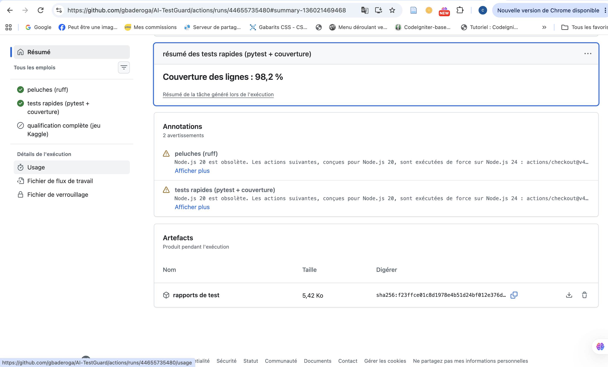
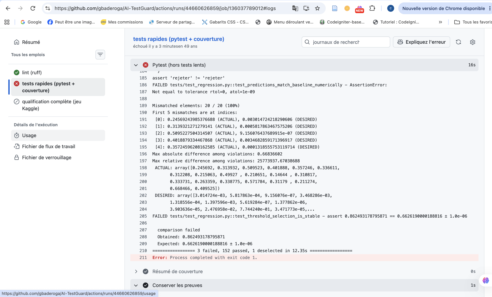

# 7. Intégration continue : GitHub Actions (Partie IX)

Workflow : `.github/workflows/tests.yml`.

## 7.1 Organisation

| Job | Déclencheur | Contenu | Durée indicative |
|---|---|---|---|
| `lint` | chaque push sur `main`, chaque Pull Request, manuel | `ruff check` (annotations GitHub dans la PR) et `ruff format --check` | < 30 s |
| `tests` | après `lint` | `pytest -m "not slow"` sur données synthétiques, couverture avec un **plancher de 85 %** (`--cov-fail-under`), rapports `junit.xml` et `coverage.xml` conservés en artefacts, couverture affichée dans le résumé du run | ≈ 1 min |
| `full-qualification` | **manuel** (`run_full_qualification`) ou **hebdomadaire** (lundi 03:17 UTC) | téléchargement de Kaggle via secrets, vérification SHA-256, tests lents, expériences, robustesse, benchmark, non-régression ; rapport en artefact | ≈ 5 min |

Choix de conception :

* **Les tests rapides ne dépendent pas du jeu Kaggle** : le jeu n'est pas versionné, pour des raisons de licence et de volume. Ils utilisent `app/synthetic.py`, qui produit des données au même schéma. La CI teste donc le **code**. La **qualité du modèle** est vérifiée par le job hebdomadaire et par la baseline réelle.
* Un échec est **clairement signalé** : code de sortie non nul, job rouge, annotations Ruff sur les lignes en cause, message `Régression détectée : {...}` qui détaille les métriques fautives, et rapport JUnit téléchargeable.
* `concurrency` annule les runs obsolètes d'une même branche. `permissions: contents: read` applique le principe du moindre privilège.

## 7.2 Mise en place sur GitHub

```bash
cd AI-TestGuard
git remote add origin https://github.com/<votre-compte>/AI-TestGuard.git
git push -u origin main
```

**Secrets**, pour le job de qualification complète uniquement : *Settings → Secrets and variables → Actions*, ajouter `KAGGLE_USERNAME` et `KAGGLE_KEY` (depuis kaggle.com → Settings → API). Ne jamais les écrire dans le dépôt : `test_security.py` le vérifie.

**Protection de la branche principale** : *Settings → Branches → Add branch ruleset* (ou *Branch protection rule*) sur `main` :

* ☑ Require a pull request before merging ;
* ☑ Require status checks to pass, en sélectionnant `lint (ruff)` et `tests rapides (pytest + couverture)` ;
* ☑ Require branches to be up to date before merging ;
* ☑ Block force pushes.

Sur un dépôt privé d'un compte gratuit, la protection de branche peut ne pas être disponible. Dans ce cas, le signaler dans le rendu, comme le permet le sujet.

## 7.3 Preuves à fournir

### Exécution réussie

1. Pousser `main` : l'onglet *Actions* affiche le run `tests` en vert (`lint` ✅, `tests` ✅).
2. Faire une capture du résumé du run (couverture affichée) et télécharger l'artefact `test-reports`.

Résultat attendu, d'après l'exécution locale à l'identique :

```
ruff check .           -> All checks passed!
ruff format --check .  -> 32 files already formatted
pytest -m "not slow"   -> 155 passed, 1 deselected ; couverture 98 %
```

### Échec volontaire, deux méthodes

**Méthode A : régression simulée, sans toucher au code.** *Actions → tests → Run workflow*, cocher `simulate_regression`. Le job `tests` échoue :

```
FAILED tests/test_regression.py::test_no_performance_regression - AssertionError: Régression détectée : {...}
FAILED tests/test_regression.py::test_predictions_match_baseline_numerically
FAILED tests/test_regression.py::test_threshold_selection_is_stable
```

**Méthode B : bogue réel dans une Pull Request**, plus convaincante pour montrer le blocage de fusion.

```bash
git switch -c demo/echec-volontaire
# Introduire un bogue : imputer les NaN au lieu de les rejeter
sed -i 's/    if nan_cols:/    if False and nan_cols:/' app/preprocessing.py
git commit -am "demo: bogue volontaire (NaN acceptés)"
git push -u origin demo/echec-volontaire   # puis ouvrir la Pull Request
```

Les tests `test_missing_values_are_rejected*` échouent, la PR affiche ✗ et le bouton de fusion est bloqué si la branche est protégée. Faire une capture, puis fermer la PR sans la fusionner.

Méthode B vérifiée localement : **7 tests échouent**, 148 passent. Parmi eux, `test_missing_values_are_rejected_with_count[V7]`, `[Amount]`, `[Time]`, `test_any_single_non_finite_value_is_rejected` (contre-exemple trouvé par Hypothesis), `test_prediction_rejects_invalid_input` et `test_robustness::test_missing_values_are_rejected` (2 cas). Le bogue est détecté à trois niveaux : unitaire, prédiction et robustesse.

## 7.4 Fichiers à joindre au rendu

* URL du dépôt ;
* `.github/workflows/tests.yml` ;
* une capture du run vert et une du run rouge (méthode A ou B), avec leurs URL ;
* l'artefact `test-reports` (junit.xml, coverage.xml).

## 7.5 Preuves obtenues

| Preuve | Run | Déclenchement | Résultat |
|---|---|---|---|
| Exécution réussie | [tests #4](https://github.com/gbaderoga/AI-TestGuard/actions/runs/44655735480) | push sur `main` | ✅ `lint (ruff)` et `tests rapides` réussis ; `qualification complète` non déclenchée (normal, job manuel ou hebdomadaire) |
| Échec volontaire détecté | [tests #5](https://github.com/gbaderoga/AI-TestGuard/actions/runs/44660626859) | lancement manuel (`workflow_dispatch`) avec `simulate_regression = true`, **même commit** | ❌ `tests rapides` en échec (exit code 1) ; `lint` réussi |

**Interprétation.** Les runs #4 et #5 portent sur le même code. Seule l'option `simulate_regression` les distingue : elle mélange les étiquettes d'entraînement. Le modèle dégradé est comparé à la baseline figée `tests/baselines/ci_baseline.json`, et les 3 tests de non-régression échouent avec le message « Régression détectée ». Tous les autres tests restent verts. La CI détecte donc précisément le défaut introduit et le signale clairement : job rouge, code de sortie non nul, message explicite.




**Remarque.** Les deux runs affichent un avertissement de dépréciation de Node.js 20 pour les actions GitHub (`checkout`, `setup-python`, `upload-artifact`). Il est sans effet sur les résultats. Il faudra mettre à jour ces actions vers leurs versions les plus récentes quand GitHub retirera Node.js 20.
